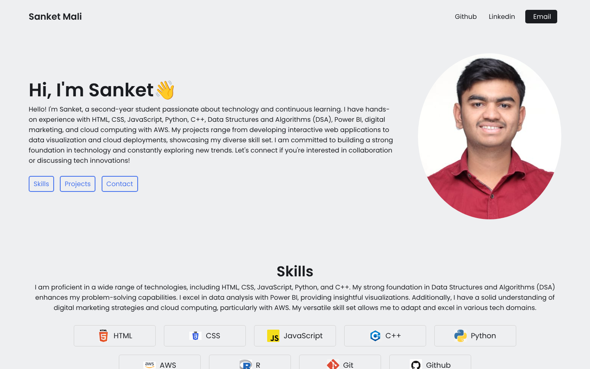
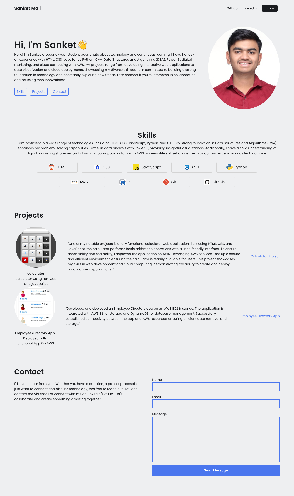

# Portfolio Website (early version)

A static single-page personal portfolio built with HTML and CSS: introduction, skills, projects and contact sections, with images in `Project Portfolio/images/`.

> My current portfolio is [React-Portfolio](https://github.com/Sanket1516/React-Portfolio) (React + Vite + Tailwind). This repository is kept as an early HTML/CSS version.

## Screenshots

  

Full page

## Run

No build step. Open `Project Portfolio/index.html` in a browser.

## Author

Sanket Mali · [GitHub](https://github.com/Sanket1516)
